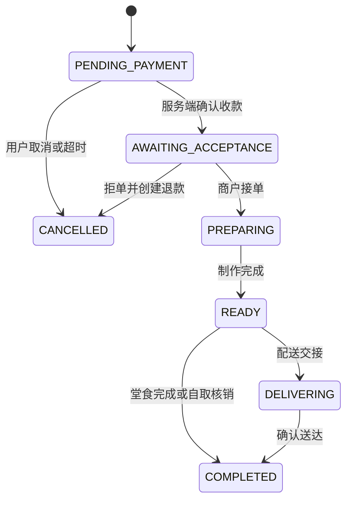

# 餐饮品牌多门店系统设计稿

日期：2026-10-20  
状态：用户已确认方案A，正在实施；R1现金交易API已运行，三端界面及后续模块继续开发  
原始依据：两张 docs 截图、`D:\Codes\开发规范.txt`  
经营模式：**同一品牌、多门店**，已经用户确认。  
完整需求：[90 项功能台账](../../../data/requirements/features.json)。

## 1. 产品目标与边界

交付一套以真实 API 和数据库为核心的餐饮经营系统：顾客完成选店、点餐、支付、取餐或配送；员工处理订单、商品、桌台、收银、会员和活动；品牌总部统一管理多门店和经营规则。所有端读取同一业务事实，不维护相互矛盾的订单状态。

原截图列出 90 项能力，覆盖经营渠道 3、基础功能 17、会员 8、商品 8、配送 9、增值 5、营销 17、分店 4、收银 19。按三个可验收交付包推进，全部保留在功能台账中；分期不意味着删除后续功能。

用户端和商户端属于两个不同的微信小程序应用，共用后台。另提供商户电脑 Web 后台；手机小程序承担高频经营，复杂表格、装修和收银工作台由电脑端承担。两个 AppID 的身份分别验证；只有经过验证且属于同一开放平台的 UnionID 或明确绑定流程才合并用户身份。

这是品牌直营/同一经营主体的初始模型。独立商户入驻、平台担保交易、加盟主体跨法人资金清算不默认启用。门店抽成先支持品牌内部核算；真实分账必须基于支付平台签约能力。

## 2. 三种实现路线

| 路线 | 具体组成 | 优点 | 代价与适用条件 |
| --- | --- | --- | --- |
| **A：模块化业务后台 + 成熟开源组件，推荐** | uni-app Vue3/TypeScript 双小程序，Vue3/Element Plus 电脑端，NestJS API，PostgreSQL/Prisma，Redis 作缓存和任务加速 | 三端共享类型与 API 合约，模块边界清晰，便于定制 UI 和真实验证；可直接使用已核查许可的组件 | 餐饮状态机、门店隔离、账本等需认真实现；Java/Go 项目中的逻辑需按本项目规则适配，不能当成已验证可复用代码 |
| B：改造 yshop-drink | Java17/Spring Boot3、MySQL、Redis、Vue3、uni-app | 餐饮、多门店、规格、会员和收银业务贴近截图，MIT，可缩短部分模块建设 | 现有代码量大，需梳理其多租户、权限、库存、券及支付实现；对源码的阅读不等于完整安全审计；UI 仍需重做 |
| C：微信云开发 | 双小程序 + 云函数 + 云数据库，电脑端连接后端 | 小团队快速上线，部署操作少 | 强事务、多门店资金账本、复杂报表和设备接入需要额外设计，长期平台耦合较强 |

推荐 A。保留成熟开源组件、事务库存模式、订单快照和支付通知机制的复用，不把多个完整商城后台拼成一个系统。若已有 Java 团队或已有 yshop 资产，可在实施前切换 B；两种后台方案不同时引入。

## 3. 可验收交付包

### R1：真实交易与双端经营

- 用户：选店、查看营业状态、堂食扫码、即时自取、预约自提、商家自配送、菜品搜索、多规格/口味/加料、购物车、真实报价、订单提交、订单追踪、个人订单及地址管理。
- 商户手机：员工登录、门店切换、营业开关、订单列表和详情、接单/拒单/备餐/出餐/核销、商品售罄、桌台状态。
- 商户电脑：门店、员工权限、分类、单位、品牌菜品模板、门店 SKU/价格/库存、订单、基础现金收银和基于实际流水的基础统计、对账。
- 后台：登录、权限、API 合约、数据库迁移、品牌和门店隔离、报价、库存预占、订单状态机、支付适配器、退款基础能力、任务 outbox、审计和日志。
- 微信支付具备完整实现及签名测试后仍需真实 AppID/商户号联调才能标记“真实支付验证通过”；配置不足时显示明确不可用状态，不能模拟已付款。开发联调可用有权限的真实现金收银完成数据库链路，但不能替代微信支付验收。
- 收银挂账不算实收，用户取消已支付单走退款；相关状态必须能在三端重新查询。

### R2：经营能力与体验完善

会员等级、储值/积分双账本、付费会员、会员优惠、积分商城、签到、领券/精准发券、券包、满减/满赠/换购/新客/生日礼；装修发布和回滚；预约、排队；完整收银草稿/挂取单、改价/抹零、协助点单、班次交接、商品导入。每个模块独立形成从页面操作到数据库持久化的验收记录。

### R3：渠道、硬件和外部履约

打印与标签、云喇叭、至少一家实际签约的同城配送供应商，再逐家扩展原截图列出的其他平台；酒水寄存；卡包；内部抽成与按签约能力实现的真实分账；支付宝和抖音独立渠道。分享红包、收藏奖励及“无痕广告”先完成产品语义和平台规则复核，再决定具体形式。所有外部能力的界面入口由实际配置与能力探测控制。

## 4. 用户端信息架构

底部导航：**首页、点餐、订单、我的**。

| 页面/流程 | 主要内容 | 必须提供的交互 |
| --- | --- | --- |
| 首页 | 当前门店、营业状态、堂食/自取/外卖入口、真实发布的活动、预约/排队 | 切换门店、查看门店详情、开关可控的优惠提示、明确的闭店提示 |
| 选店 | 搜索门店、服务类型、地址和营业时段 | 定位为可选；拒绝后可手动选店；切店前提示处理当前购物车 |
| 点餐 | 分类联动、菜图、名称、价格、已售罄和搜索 | 加减份数、规格底部面板、必选项校验、加入购物车反馈 |
| 购物车 | 按门店与履约场景分开，组合 SKU 合并 | 修改口味/数量、清空确认、失效商品逐项说明、报价变化确认 |
| 结算 | 就餐方式、桌号/自提时段/地址、费用明细、优惠券、备注 | 服务端报价、可用券原因、营业/配送校验、提交防重、支付取消后继续付款 |
| 订单详情 | 支付状态、履约进度、菜品快照、取餐号、退款状态 | 联系门店、取消/售后、重新支付、再次购买时重新校验菜单 |
| 我的 | 本人资料、会员权益、余额/积分流水、优惠券、地址、隐私设置 | 用户主动绑定手机号、必要时单独授权、退出登录和信息删除申请 |
| 预约/排队 | 时段、人数、桌型、押金、队列进度 | 容量冲突即时反馈、取消/过号/叫号可见，消息授权拒绝不影响已有服务 |

不以手机号、定位、头像或生日授权作为浏览菜单的前提。堂食根据经验证的桌台上下文展示当前桌号，不让普通顾客选择任意历史桌台会话读取别人的订单。

## 5. 商户端信息架构

商户小程序底部导航：**工作台、订单、商品、门店**。收银、会员、桌台、排队从工作台常用入口进入，入口按服务端实际权限显示。

- 工作台：门店选择、营业状态、待处理订单、已出餐待取、低库存/售罄提醒和当天实收。没有实际流水时显示 0 和可行动的空状态。
- 订单：状态筛选、搜索取餐号、接单/拒单原因、备餐、出餐、核销、退款申请处理；读写操作均有请求失败反馈。
- 商品：快速搜索、门店上下架、规格库存、售罄/恢复；品牌模板编辑权限和门店经营权限区分。
- 门店：营业时段、服务方式、桌台、配送范围、员工与权限、设备、帮助；敏感配置只给授权管理员。
- 电脑后台：侧栏按经营工作分组为工作台、订单、收银/桌台、商品、会员、营销、门店、数据、设置。每页保留面包屑、筛选、分页、保存状态。
- 电脑收银：商品搜索和分类、图片/列表切换、购物清单、会员查询、挂取单、折扣/抹零、收款面板、桌台和班次。扫码枪录入经平台收单能力接入，不能把扫描任意二维码当成已付款。
- 厨房角色只看必要的菜品、数量、口味、桌号、出餐和叫号信息，不读取完整会员资料与财务数据。

## 6. 视觉、动效与可修改能力

视觉方向：自然餐饮品牌，暖白底、深墨色文字、克制的橙红主色与食物图片。用户端以菜单和操作为中心，商户端以订单密度、状态辨识和快捷操作为中心。正式品牌名称、Logo、图片与菜品都通过后台和素材管理配置，设计稿中的示意不写成正式业务数据。

- 全局 token：颜色、字体、字号、圆角、间距、阴影、动效时长、按钮尺寸、安全区。正文和辅助文案实际显示尺寸均不小于 14px；主要触点不小于 44px。
- 语义颜色同时搭配文字/图标，避免仅依颜色区分付款或出餐状态。
- 加购按钮约 120ms 压下反馈，购物车数量约 180ms 轻微缩放；规格面板约 240ms 平滑展开；页面内容约 180ms 淡入，避免大范围逐项表演动画。
- 分类滚动联动保持选中项可见；底部购物车不遮挡系统安全区；结算费用展开保留焦点。
- 加载用骨架和局部 loading；提交中按钮禁重复点击，后端仍校验幂等。服务端未确认前不展示交易成功。
- 低性能设备、系统降低动态效果设置可关闭非必要动画。小程序真机验证 CSS、触摸、软键盘和返回行为。
- 装修采用有限组件：门店头部、横幅、服务入口、商品集合、领券、公告、文章。只能编辑白名单属性，不能上传任意可执行脚本。
- 商户拖拽排序、属性编辑和移动端预览，保存草稿后发布；记录版本、校验图片和链接、支持回滚。订单、支付、权限及隐私界面不允许装修绕过。
- 商品、活动、营业时间、配送费、会员规则属于业务配置，存数据库；API 域名与密钥属于部署配置，不在装修器中暴露。

## 7. 工程组织

采用 pnpm workspace，先保持模块化单体 API，不提前拆成微服务。

```text
013MiniProgram/
  apps/
    customer-mini/        # uni-app 顾客小程序，同时构建 H5 联调版
    merchant-mini/        # uni-app 商户小程序，同时构建 H5 联调版
    merchant-web/         # Vue3 电脑后台与收银
    api/                  # NestJS 业务 API
      src/
        common/           # 认证守卫、校验、错误、日志、请求上下文
        modules/
          identity/ brand/ stores/ staff/ catalog/
          inventory/ pricing/ orders/ payments/ refunds/
          members/ wallets/ points/ coupons/ marketing/
          tables/ cashier/ reservations/ queue/ cms/
          delivery/ printing/ reconciliation/ audit/
      prisma/             # Schema、版本化迁移
  packages/
    contracts/            # DTO、金额/状态定义、接口合约
    api-client/           # 公共错误语义，Web/uni 请求 transport 分离
    design-tokens/        # 三端共享设计变量
    mini-components/      # 双小程序复用 Vue 组件
    config-schema/        # 启动配置校验规则
  config/
    README.md
    environments/         # 三环境说明；仅模板，不保存秘密
    integrations/         # 支付、配送、打印能力说明
    deployment/           # 上线域名与部署记录
  data/
    requirements/         # 原截图需求结构化台账
    research/             # 来源清单；raw 缓存不入库
    seeds/                # 独立体验/测试数据，生产禁止自动灌入
    imports/              # 导入模板和校验报告
    backups/              # 实际备份不入 Git
  tests/
    integration/ e2e/ fixtures/
  scripts/                # 校验、初始化、备份和恢复
  deploy/                 # Compose、反向代理、健康检查
  docs/
    research/ architecture/ acceptance/ superpowers/
```

上述 `apps`、`packages` 等是**拟实施结构**，当前并未生成应用空壳来冒充完成。当前已建立的 data/config/docs 用于保存需求、证据和设计说明。

每个 API 模块按 controller、service/domain、repository、DTO 拆分。跨模块使用明确服务接口；库存、支付、会员余额不由页面自行计算后写库。API 合约生成前端类型，避免多份状态枚举。

运行基线拟采用 Node.js 22 LTS、pnpm 10、PostgreSQL 16、Redis 7。当前机器检测到 Node 24.15.0、npm 11.12.1、Python 3.14.5；这些是当前环境观察，不代表依赖已验证兼容。实施时先验证完整构建链，并锁定依赖。所有 `@dcloudio/uni-*` 包必须来自相同编译器版本，不把旧模板和最新组件随意混装。

## 8. 数据边界与核心模型

- 品牌：全局规则、会员身份、会员等级、商品模板、营销模板、主题和发布版本。
- 门店：营业时段、商品可售配置、SKU 库存、门店覆盖价格、订单、桌台、取餐号、班次和设备。
- 默认会员权益为品牌通用；储值通用开关上线前必须由实际经营主体确认。账本保留发生门店和归属主体，跨店消费不能用前端余额抵扣。
- 品牌角色、门店角色与员工门店授权分开建模。服务端查询条件显式注入品牌和允许门店；用户传入 storeId 不能提升权限。
- 价格全部使用整数分，人民币 CNY；不要使用二进制浮点累加金额。时间存 UTC，营业日和签到按 Asia/Shanghai；营业日截点为门店可配置项，覆盖跨午夜营业。
- 订单保存商品、规格、口味、加料、价格、优惠分摊、地址、配送费和规则版本快照，菜品编辑不会改变历史订单。
- 数据域详细表、索引和不变量见 `docs/architecture/domain-model.md`。

## 9. 报价、库存与优惠

1. 用户提交门店、履约方式、SKU、数量、属性、加料、地址/时段和候选优惠券，不提交可被信任的应付金额。
2. 后端从数据库读取当前价格和库存、校验模式/营业/配送范围、计算报价；返回 quoteId、价格明细、优惠分摊、有效期和版本。
3. 订单创建时再次校验报价和版本；价格变化返回 PRICE_CHANGED 与新报价，要求用户确认。
4. 同事务写订单及快照、条件更新 SKU 与加料库存、预占券、写库存预占流水和 outbox。任一 SKU 不足整体回滚。
5. 订单待支付保留库存，到期通过可重入任务释放；支付与到期任务对同一订单使用状态条件更新/行锁。
6. 优惠顺序：商品活动/会员价选适用最优且按规则互斥 → 店铺满减 → 允许叠加的一张订单券 → 配送费减免 → 明确授权的积分抵现。会员余额是支付方式，不是优惠。
7. 门槛默认基于可参与商品的活动后金额，不包含配送费和打包费；规则可配置并必须在活动中明确。赠品、换购品与不可优惠品独立核算。
8. 优惠分摊到订单行，整数余数使用确定性分配，保证各行应付之和等于总应付；部分退款按快照计算，不按当前活动重算。
9. 取消未付款订单释放券和库存；全额/部分退款按规则撤销积分及赠礼。已制作餐品不因退款自动回补可售食物库存，由门店按退款原因选择报损或可回补。

## 10. 订单、支付和退款分别建状态机

订单业务类型为 ORDERING（含堂食/自取/外卖）、QUICK_PAY（金额买单）、POS（收银），充值/券包/付费会员使用独立购买单及统一支付流水。



支付状态：UNPAID、PENDING、PAID、CLOSED。退款作为独立实体 NONE/APPLIED/PROCESSING/SUCCEEDED/FAILED；一个订单可以有多笔部分退款，不用“已退款”覆盖全部履约历史。原支付单保留成功事实，已退金额来自退款账本。

微信支付使用 API v3：服务端下单并签名、前端调起；回调保存原始报文用于验签（敏感内容受限存储），按证书/公钥 ID 选公钥，验证时间窗与签名、解密后核对 appid、mchid、订单号、币种和订单总额，再条件更新付款状态。商家营销优惠存在时区分订单总额与用户实付字段，不能把 payer_total 当成唯一应付校验字段。

回调收妥并持久化后在官方要求时间内应答；打印、积分、消息通过事务 outbox 异步执行。同事件唯一约束与状态检查应对重复通知，主动查单处理遗漏。支付回调与取消竞态必须查询真实交易结果；已被取消订单迟到付款进入退款/人工处理路径，不丢失到账事实。

退款受理成功只进入 PROCESSING，回调或查单确认后进入 SUCCEEDED。按支付单加锁核验“已退款 + 处理中 + 本次金额 <= 可退金额”。重试沿用原退款单号，不能每次生成新退款单。

## 11. API、权限和失败处理

API 前缀 `/api/v1`。认证令牌以真实微信 code 或员工凭据建立；生产无任意角色切换/万能测试登录。Web 管理端与小程序根据各自 transport 安全保存短期凭据，刷新 token 轮换并可撤销。

响应结构：`{ data, requestId }`；错误：`{ error: { code, message, details? }, requestId }`。金额字段后缀 Fen，分页默认 20、最大 100；订单流使用游标避免实时插单导致漏读。关键写操作要求 Idempotency-Key 并记录主体、路由、请求体哈希；同 key 异体返回冲突。

权限例：
- 用户查询/取消自己的订单；退款依状态与策略。
- 店员操作授权门店的订单，不能管理品牌规则。
- 收银员按额度改价，不能给自己提升权限；退款和大额减免可要求店长确认。
- 店长管理自己门店的员工授权、库存、预约、班次。
- 品牌管理员管理门店和全品牌模板，财务角色单独授予；财务日志不能随意修改。

网络读请求有限重试；订单创建、退款、储值扣款仅在稳定幂等键下恢复，不能盲目重发。数据库不可用时返回可追踪错误并保留购物车，不伪造下单成功。Redis 故障不能影响数据库库存/余额真实性；关键状态依 PostgreSQL 事务，不依 Redis 锁作为唯一保护。

第三方适配器具备请求超时、错误分类、有限重试、熔断和恢复探测。配送未成功创建时显示“待安排配送”；打印离线可补打且标识补打，不能重复发出真实交易。缺少配置不返回假成功。

## 12. 页面装修与配置分层

1. 部署配置：API 地址、数据库连接、对象存储、微信密钥等，环境变量或密钥管理，按环境隔离。
2. 品牌业务配置：视觉主题、会员及营销政策、品牌门店范围，数据库版本化。
3. 门店业务配置：营业、配送、库存、价格覆盖和设备，后端权限校验。
4. 页面内容：白名单装修 Schema，草稿/预览/发布/回滚，不允许更改业务安全规则。

配置模板及每项用途见 `config/README.md`。配置缺少必要项时启动失败；按需启用的集成缺少项则该能力不可用。所有实际域名、AppID、商户号和部署记录必须通过真实环境提供并验证，不在文档中编造。

## 13. 验证和验收

使用单元测试验证金额、优惠、状态转换；使用真正的 PostgreSQL 集成测试验证幂等、事务、并发库存和权限；用 Playwright 操作 H5/电脑端并核对数据库；用微信开发者工具和真机验证小程序。H5 通过不能代替小程序真机通过，签名 fixture 通过不能代替真实支付到账。

重点用例：
- 门店 A 员工传门店 B 的 ID 被拒绝；顾客不能读取他人订单。
- 同一库存 1 份同时发出 20 个不同用户订单，最多一个成功预占；失败方没有订单扣款或券损失。
- 同一提交幂等键重发只生成一个订单；同键不同商品返回冲突。
- 切店前处理原购物车；关闭门店后不能继续使用旧报价下单。
- 支付回调重复、乱序、错金额、错 appid、错商户号、过期时间戳与坏签名不产生重复收款或权益。
- 商家优惠存在时校验订单总额与用户实付语义，避免误拒真实付款。
- 取消与回调并发不产生“付了钱但没有任何可追踪记录”。
- 两笔并发退款不可超额；退款失败不增加已退金额。
- 券限领、余额不足、积分并发、生日修改、预约容量和排队重复取号有明确结果。
- 三端刷新后数据持久一致，统计与流水可复算。
- 断网、超时、服务重启、打印离线、配送创建失败均保留真实业务状态。
- 装修保存草稿对用户不可见；发布后生效；错误 Schema 拒绝；回滚恢复历史版本。

每项功能分别记录已编写、已运行、已测试通过、已上线验证。当前这四种应用验证状态均为未开始，不能把调研下载成功列作应用功能测试通过。

## 14. 上线、运维与维护

部署采用 API 服务 + PostgreSQL + 可选 Redis worker + 静态 Web + HTTPS 反向代理；开发、测试、生产使用不同数据库、凭据和对象存储前缀。小程序配置 request/upload/download/socket 合法域名及隐私声明；支付回调公网 HTTPS 可达。

数据库迁移先在测试环境执行，生产变更先备份；回滚应用版本与数据库兼容窗口分开设计。定时任务包括超时订单关闭、支付/退款查单、过期库存释放、积分权益任务、打印配送补偿和对账。日志携带 requestId、主体和门店，敏感信息脱敏。

数据库定期备份、配置加密备份、对象存储生命周期、恢复演练必须有记录。真实支付、打印、配送、真机和生产验收需要经营主体的实际账号、设备和环境；这些外部条件不妨碍先完成业务实现和本地测试，但未提供前不能宣布整体上线交付完成。

## 15. 已确定与仍需真实环境提供的信息

已确定：品牌多门店；用户与商户双小程序；电脑后台；真实数据库；可编辑业务和页面；有交互与克制动效；90 项完整追踪；开源许可核查。

本设计采用默认规则：品牌商品模板 + 门店价/库存、品牌会员、统一人民币分、上海营业时区、三端共用 API、先做 R1 后扩 R2/R3。品牌名称/Logo、门店资料/菜品、储值适用范围、AppID/微信支付、生产域名/主机、实际配送打印设备由实际经营环境确定。它们不会被虚构填充。

## 16. 设计审阅结论

设计已自查：需求数量与截图逐项对应；三端和业务数据边界一致；支付、退款、履约分别建模；外部能力与本地功能验证不混淆；没有已实现或已上线的虚假声明。

待用户确认采用 A，或明确切换 B/C 后进入实施。开源调研报告、数据模型、验收与配置说明会随本设计一并维护。

